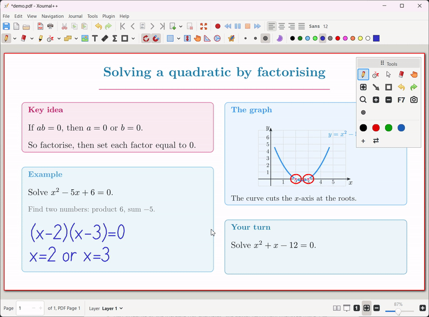
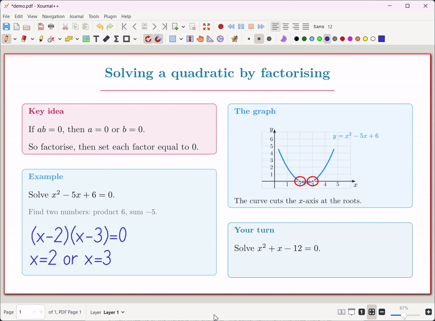
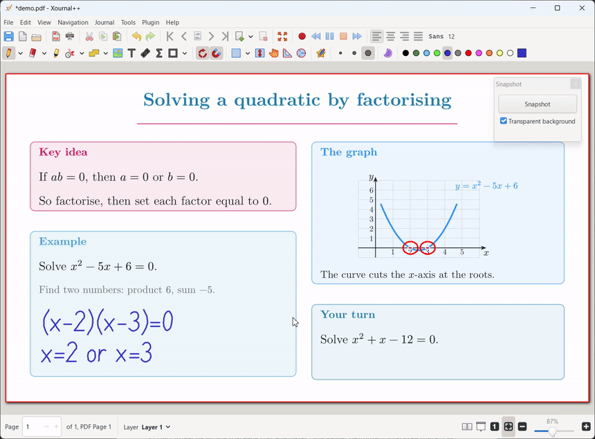
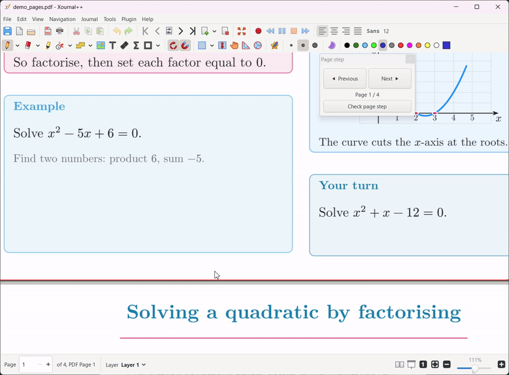
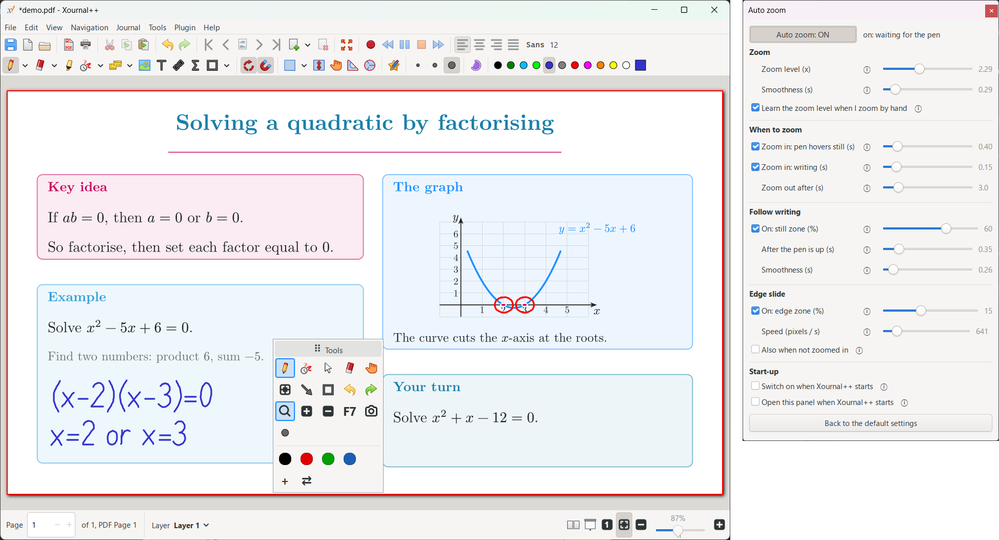
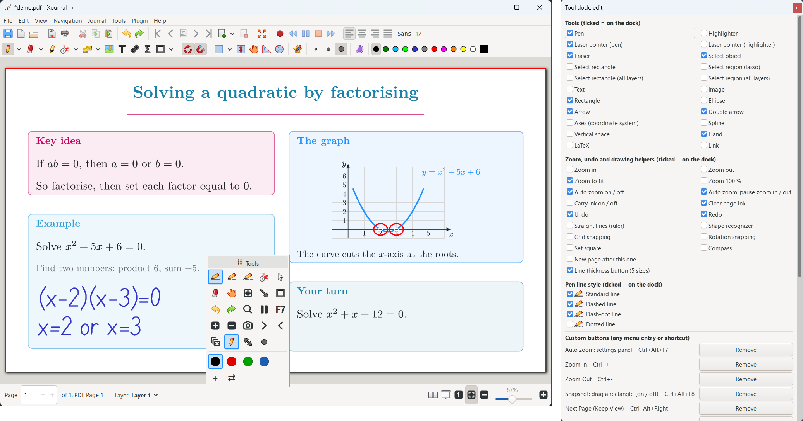

# Xournal++ plugins for teaching with a pen

I use [Xournal++](https://github.com/xournalpp/xournalpp) in my lessons with a Wacom pen. A few small things kept slowing me down, so I wrote these
four plugins to fix them. I use them every day now.

They're made around the way I work, so some choices are just my own taste. If you write a lot with a pen
in Xournal++, I hope they make your work easier too.

| Plugin | What it does |
|---|---|
| [tool-dock](tool-dock) | A small floating panel with your tools, colours and line sizes. Put it right next to where you write. |
| [autozoom](autozoom) | Zooms in where the pen is writing, follows along, and zooms back out when you stop. |
| [snapshot](snapshot) | Drag a box over part of the page and get a copy of it as a picture you can move around. |
| [preserve-view](preserve-view) | Next / previous page without losing your place. If you were zoomed in on the top left corner, you stay there. |

Each plugin works on its own, so you can take only the ones you want.

Thanks to the Xournal++ team for a great program and its plugin system. These plugins aren't part of
Xournal++. They're just something I made for my own needs and wanted to share, as they are.

## See them in action

**tool-dock.** Move the dock next to your writing and pick your tools and colours right there.

**autozoom.** Hold the pen still and it zooms in. Write, and it follows you. Move away, and it zooms back out.

**snapshot.** Copy part of the page and drag it wherever you need it.

**preserve-view.** Go to the next page and stay in the same spot, at the same zoom.

## What they fix

**tool-dock.** The toolbar is at the top of the window, and I usually write lower down. Every change of
colour or tool meant a long trip with the pen. Now the buttons sit right beside my writing. The dock stays
open where you put it (the built-in floating toolbox closes after each pick), shows which tool and colour
you're using, and can hold colours, line sizes, shapes (arrow, rectangle, axes ...), zoom and undo
buttons. You can also add a button for any menu item that has a shortcut.

**autozoom.** At full-page zoom my handwriting is small, and zooming in and out by hand all the time breaks
my flow. Autozoom does it for me. It uses Xournal++'s own zoom, so the page stays sharp at every level.

**snapshot.** I often want to bring a diagram or a line of working down next to what I'm writing. The
plugin cuts the box out of the page, PDF and ink together, and puts it back in the same place as a picture.
It's already selected, so you can drag it straight away, and Ctrl+Z takes it away again.

Two things I really like about it:

- **See-through background.** The white of the page (or the colour of a card on your slide) is taken out,
  so only the writing and the drawing are left. You can drop the copy over a coloured box or on top of
  other work and it won't cover anything with a white square. The edges of the letters stay smooth, with no
  white rim. If you want a normal solid picture instead, just untick *Transparent background* in the
  snapshot window.
- **It's on the clipboard too.** Every copy also goes to the clipboard at full sharpness, so you can press
  Ctrl+V in Word, PowerPoint, Paint and so on. Programs that understand transparency get the
  see-through picture; Paint doesn't, so there you get it on the page colour.

**preserve-view.** My slides are PDFs. When I'm zoomed in and go to the next page, Xournal++ lands
somewhere else on it and I have to scroll back. This plugin moves exactly one page, so the view stays where
it was.

**Together** they cover most of what I used to do with the dial and the buttons on my tablet, or with
keyboard shortcuts. The zooming happens by itself, the tools and colours are right next to the pen, and
pages turn with a tap. Now I hardly touch the dial or the tablet keys while I write, and I can keep my
eyes and my hand on the page.

## Make them your own

Everyone writes differently, so I made each plugin easy to set up the way you like. What you change in
their panels works straight away and is saved by itself, with no restart.

**autozoom** has its own settings panel (Ctrl+Alt+F7), a small floating window with sliders and tick boxes
in five groups:

- **Zoom:** how far it zooms in, how smooth the movement is, and whether it should learn your zoom level
  when you zoom by hand.
- **When to zoom:** zoom in when the pen hovers still, when you start writing, or both, each with its own
  timing, and how long to wait before zooming back out.
- **Follow writing:** how big the still zone in the middle is, how long to wait after the pen lifts, and
  how smoothly the view glides after your writing.
- **Edge slide:** how close to the edge the pen has to be, how fast the view slides, and whether it should
  slide even when you're not zoomed in.
- **Start-up:** switch auto zoom on and open the panel when Xournal++ starts, plus a button to go back to
  the default settings.

<picture>
  <source media="(prefers-color-scheme: dark)" srcset="docs/images/autozoom-panel-dark.png">
  
</picture>

**tool-dock** is set up from its **+** button, which opens an edit list:

- Pick the tools you want with tick boxes (every tool your Xournal++ has), plus zoom, undo, redo, ruler,
  set square, compass, grid snapping, new page and more.
- Add your own colours with the normal colour picker, and remove the ones you don't use.
- Add a button for any menu item that has a shortcut, for example next page or a snapshot.
- Choose the shape (a row, a column or a block with up to 12 buttons per row) and the button
  size (small, medium, large).
- Give the dock buttons, colours and line sizes their own shortcut keys. They work even when the dock is
  hidden.
- To take a button off the dock, hold it for a moment or right-click it.

<picture>
  <source media="(prefers-color-scheme: dark)" srcset="docs/images/dock-edit-dark.png">
  
</picture>

**snapshot** has a small window (Ctrl+Alt+F9) with the Snapshot button and the *Transparent background*
tick box. In its `settings.txt` you can also choose how sharp the picture is, where the copy lands next to
the original, whether it goes to the clipboard, and how strongly the background is cleaned out.

**preserve-view** has a small *Page step* window (Ctrl+Alt+F11) with big Previous / Next buttons you can tap
with the pen, the page number, and the page step check. In `settings.txt` you can set how far one nudge
moves the view.

Every plugin keeps its settings in a `settings.txt` file in its own folder, so you can also change them
there (with Xournal++ closed), including all the shortcut keys.

## What you need

The normal **stable** release is all you need: Xournal++ **1.3.8 or newer**, from the
[Xournal++ releases page](https://github.com/xournalpp/xournalpp/releases). That's the one I'd pick.

The plugins also run on the **nightly** build (I use that one myself), but you don't need it. The only
difference is inside: the nightly gives plugins a newer way to read where you are on the page, and on
stable the plugins read the scroll bars instead. I checked both side by side and they land in the same
place, and you won't feel any difference in speed.

Xournal++ 1.2 and older won't work, because plugins there can't open their own windows.

About your system:

- I've only tried them on Windows 11. They should work on Linux too, but I haven't tested that.
- On Linux with Wayland, start Xournal++ with `GDK_BACKEND=x11`. Otherwise the floating windows can't be
  placed and autozoom can't follow the pen.

## Installing

1. Download the zip from the [Releases](../../releases) page (or clone the repo).
2. Copy the plugin folders you want into Xournal++'s plugins folder:
   - Windows: `%LOCALAPPDATA%\xournalpp\plugins`
   - Linux: `~/.config/xournalpp/plugins`
3. Restart Xournal++. Each plugin gets its own entry in the **Plugin** menu, for example
   *Plugin > autozoom*. You can switch plugins on or off under *Plugin > Plugin Manager*.

## Shortcut keys

| Key | Plugin | Does |
|---|---|---|
| Ctrl+Alt+F12 | tool-dock | show / hide the dock |
| Ctrl+Alt+F5 | autozoom | auto zoom on / off |
| Ctrl+Alt+F6 | autozoom | zoom in at the pen now / zoom out now |
| Ctrl+Alt+F7 | autozoom | settings panel |
| Ctrl+Alt+F8 | snapshot | drag a box to copy |
| Ctrl+Alt+F9 | snapshot | snapshot window |
| Ctrl+Alt+Right / Left | preserve-view | next / previous page, same view |
| Ctrl+Alt+Down / Up | preserve-view | nudge the view down / up |
| Ctrl+Alt+F10 | preserve-view | check the page step (see below) |
| Ctrl+Alt+F11 | preserve-view | Page step window |

You'll find all of these in the **Plugin** menu too. To change a key, close Xournal++, open `settings.txt`
in that plugin's folder and edit the `KEY_...` line, for example `KEY_RECT=<Shift>F2`, or `none` for no
key.

## After updating Xournal++

The plugins work out where the pages are from the way Xournal++ lays them out. If a future version changes
that, things could end up in the wrong place. So after an update, open a PDF with a few pages and choose
*Plugin > preserve-view > Check Page Step* (or press Ctrl+Alt+F10). If it says "Check OK.", you're fine.
Autozoom and snapshot check this by themselves and tell you in their window if something is off.

## If something doesn't work

Each plugin keeps a short log in your temp folder (`%TEMP%\autozoom.log`, `snapshot.log`,
`tool-dock.log`, `preserve-view.log`). Have a look there first: it usually shows what went wrong.

## More details

Each plugin's folder has its own README with all its settings, and a CHANGELOG with what changed in each
version. If you want to change the code or run the tests, see [DEVELOPING.md](DEVELOPING.md).

## Licence

MIT. Use them, change them, share them. If you build on them, a mention is appreciated.

I wrote these with a lot of help from Claude (Anthropic's AI) and tested every version myself.
