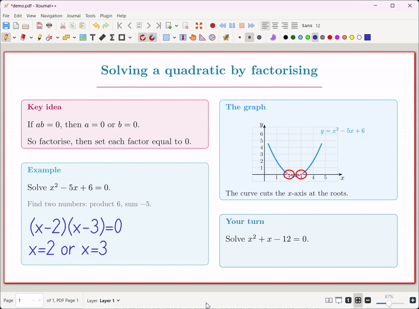
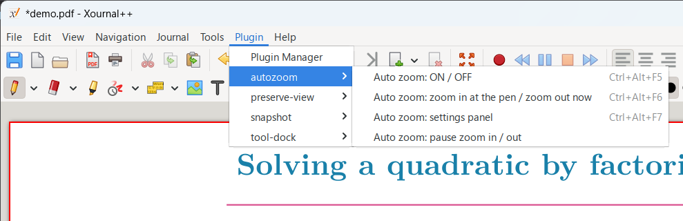
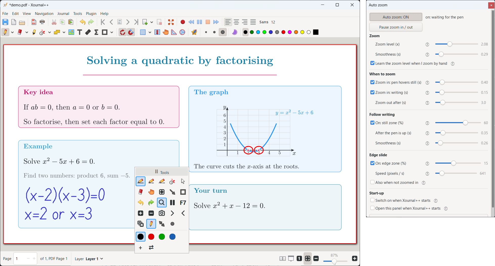

# autozoom

Zooms in where the pen is writing, follows your writing, and zooms back out when you stop. It uses
Xournal++'s own zoom, so the PDF is redrawn at the new size and the page stays sharp at every level.

Hold the pen still and it zooms in. Write, and it follows you. Move away, and it zooms back out.

Version 0.16.1. Needs Xournal++ 1.3.8 or newer (stable or nightly). What changed in each version:
[CHANGELOG.md](CHANGELOG.md).

## Keys (also in the Plugin menu)

| Key | Does |
|---|---|
| Ctrl+Alt+F5 | Auto zoom on / off. A small note shows for a second (nothing to click). |
| Ctrl+Alt+F6 | Zoom in at the pen now / zoom out now (only while it's on). |
| Ctrl+Alt+F7 | Settings panel. |
| (no key) | Pause zoom in / out (see below). Also a button in the panel and on the tool dock. |

To change a key: close Xournal++, open `settings.txt` in this folder and edit `KEY_TOGGLE`, `KEY_NOW`,
`KEY_PANEL` or `KEY_PAUSE`, for example `KEY_TOGGLE=<Control><Shift>Z`, or `none` for no key.

<picture>
  <source media="(prefers-color-scheme: dark)" srcset="../docs/images/menu-autozoom-dark.png">
  
</picture>

## How it behaves while it's on

- **Zoom in:** hold the pen still just above the tablet for a moment, or just start writing. The spot under
  the pen stays under the pen.
- The view never moves while the pen tip is down. Every movement happens with the tip up; a zoom that starts
  while you write moves only in the gaps between strokes.
- **Follow:** when your writing leaves the still zone (the middle part of the view), the view glides after
  it once the pen has been up for a moment (0.35 s, so not between letters).
- **Edge slide:** hold the pen (tip up) near an edge of the page area for half a second and the view
  slides that way. It can also work when you're not zoomed in (a tick in the panel).
- **Zoom out:** after 3 seconds without writing or pen movement. The view goes back to where it was. If you
  went to another page in the meantime (by scrolling, or with the preserve-view keys), it goes back to the
  same place on that page.
- **Your own zoom:** change the zoom yourself while zoomed in (toolbar buttons, tablet dial, Ctrl+wheel)
  and the plugin takes it as the new zoom level and uses it from then on. Zoom back to the normal view or
  below and the plugin lets go and keeps your view.
- **Pause:** the zoom stays as it is, with no zoom in and no zoom out by itself, but the edge slide and
  the follow glide keep working (the edge slide also when you're not zoomed in). Handy when you want to
  stay at one zoom and move around the page with the pen. Ctrl+Alt+F6 still zooms in or out. Press it again
  and auto zoom zooms by itself again. Pause while auto zoom is off switches it on, paused. Switching it
  off ends the pause, and Xournal++ always starts unpaused.
- Movements start and stop softly, with no overshoot, and can turn round at any moment without a jump.
- It doesn't zoom while you use a selection tool, the hand or the eraser, while something is selected, or
  while another program is in front of Xournal++. The pen over a menu, a dialog or one of the plugin
  windows doesn't count either.

## Settings panel (Ctrl+Alt+F7)

<picture>
  <source media="(prefers-color-scheme: dark)" srcset="../docs/images/autozoom-panel-dark.png">
  
</picture>

A small floating window. It stays above Xournal++, can be dragged anywhere and resized (place and size are
remembered), and never takes the keyboard. The pen over the panel never starts a zoom. Every change works
at once and is saved by itself.

| Group | Setting | Default | What it means |
|---|---|---|---|
| | Auto zoom: ON / OFF | off | same as Ctrl+Alt+F5; the text beside it shows what the plugin is doing |
| | Pause zoom in / out | not paused | pressed = no zoom in / out by itself, edge slide and follow still work |
| Zoom | Zoom level | 1.60 | how much to zoom in |
| | Smoothness | 0.40 s | how soft the zoom is; the whole movement takes about 3 times this |
| | Learn the zoom level when I zoom by hand | on | off = a zoom by hand makes the plugin let go |
| When to zoom | Zoom in: pen hovers still | on, 0.40 s | |
| | Zoom in: writing | on, 0.20 s | pen-down time; short strokes add up |
| | Zoom out after | 3.0 s | without writing or pen movement |
| Follow writing | On: still zone | on, 60 % | middle part of the view where writing doesn't move the view |
| | After the pen is up | 0.35 s | wait before the glide |
| | Smoothness | 0.45 s | how soft the glide is |
| Edge slide | On: edge zone | on, 10 % | |
| | Speed | 900 px/s | at the very edge |
| | Also when not zoomed in | off | the pen scrolls the page on its own |
| Start-up | Switch on when Xournal++ starts | off | |
| | Open this panel when Xournal++ starts | off | |
| | Back to the default settings | | the panel's place and size stay |

Both "Zoom in" ticks off = manual only (Ctrl+Alt+F6).

## Good to know

- If something looks wrong, the log is in `%TEMP%\autozoom.log`.
- Every time a zoom starts, the plugin checks that it still understands Xournal++'s page layout. If a new
  Xournal++ version changes it, the panel says "layout check failed, see the log".
- Pages side by side, horizontal layout and "add vertical space" don't fit the plugin's page model. It still
  works there, but the spot under the pen can move a little when it zooms.
- I haven't checked yet what happens if you close Xournal++ while auto zoom is on or the panel is open. That's
  why both start-up ticks are off by default.
