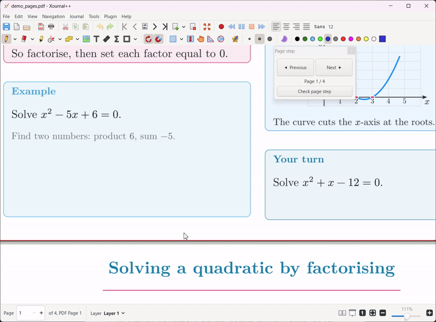
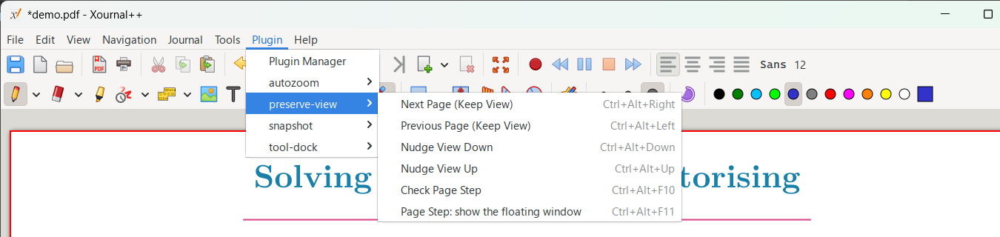
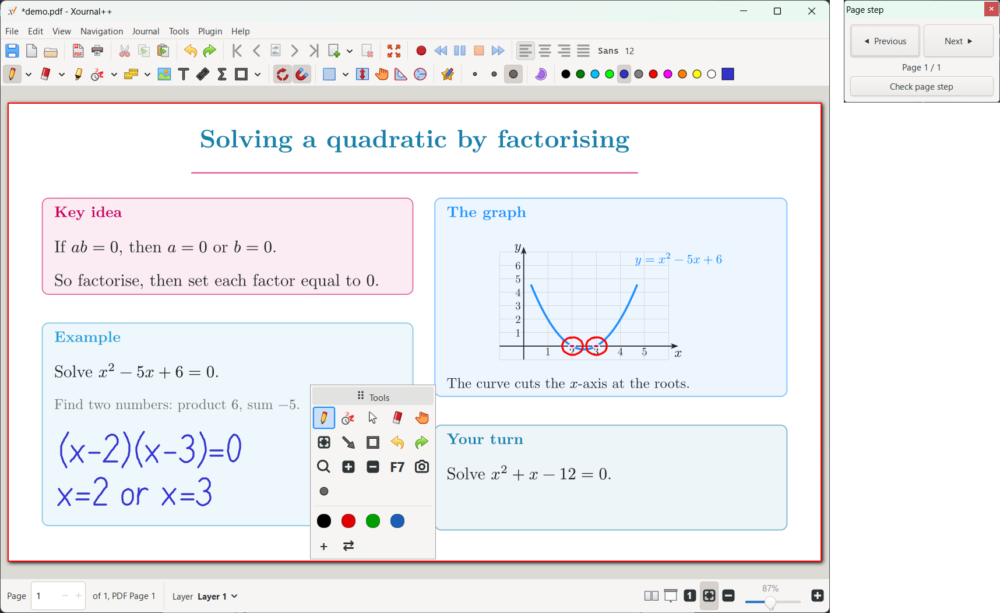

# preserve-view

Next / previous page without losing your place. If you're zoomed in on the top left corner of a page and go
to the next one, you land on the top left corner of the next page, at the same zoom.

I made it for slide decks where each page is one step of the same slide: going forward should look like
the next step appearing, not like the view jumping somewhere else.

Go to the next page and stay in the same spot, at the same zoom.

Version 2.7. Needs Xournal++ 1.3.8 or newer (stable or nightly). What changed in each version:
[CHANGELOG.md](CHANGELOG.md).

## Keys (also in the Plugin menu)

| Key | Does | Name in settings.txt |
|---|---|---|
| Ctrl+Alt+Right | next page, same view | `KEY_NEXT` |
| Ctrl+Alt+Left | previous page, same view | `KEY_PREVIOUS` |
| Ctrl+Alt+Down | nudge the view down a little | `KEY_NUDGE_DOWN` |
| Ctrl+Alt+Up | nudge the view up a little | `KEY_NUDGE_UP` |
| Ctrl+Alt+F10 | check the page step | `KEY_CHECK` |
| Ctrl+Alt+F11 | show the Page step window | `KEY_PANEL` |

To change a key: close Xournal++, open `settings.txt` in this folder and edit the `KEY_...` line, for
example `KEY_NEXT=<Control>Page_Down`, or `none` for no key.

<picture>
  <source media="(prefers-color-scheme: dark)" srcset="../docs/images/menu-preserve-view-dark.png">
  
</picture>

## Page step window (Ctrl+Alt+F11)

<picture>
  <source media="(prefers-color-scheme: dark)" srcset="../docs/images/pagestep-dark.png">
  
</picture>

A small floating window with big **Previous** and **Next** buttons you can tap with the pen (no key
presses while you write), the page number, and the page step check. It stays above Xournal++, never takes
the keyboard, and remembers its place.

You can also add a Next / Previous button to the tool-dock with a custom button
(*Plugin > Next Page (Keep View)*).

## Check Page Step

The plugin works out exactly how far one page is from Xournal++'s page layout. After a Xournal++ update,
open a PDF with a few pages and choose *Plugin > preserve-view > Check Page Step* (or Ctrl+Alt+F10).
"Check OK." means everything's fine. You won't need it otherwise.

## Settings (`settings.txt` in this folder)

The plugin writes this file itself. Change it with Xournal++ closed.

| Setting | Default | What it means |
|---|---|---|
| `NUDGE_PX` | 5 | how far one nudge moves the view (screen pixels) |
| `PANEL_AT_START` | false | open the Page step window when Xournal++ starts |
| `PANEL_X`, `PANEL_Y` | -1 | window place (saved by itself) |
| `KEY_...` | see above | shortcut keys |

## Good to know

- If something looks wrong, the log is in `%TEMP%\preserve-view.log`.
- Pages of different heights work too.
- On the last page, a view far down the page can land a little short, because Xournal++ won't scroll past
  the end of the document. Going back still returns to the right place.
- It expects one page per row (the normal layout), not pages side by side.
