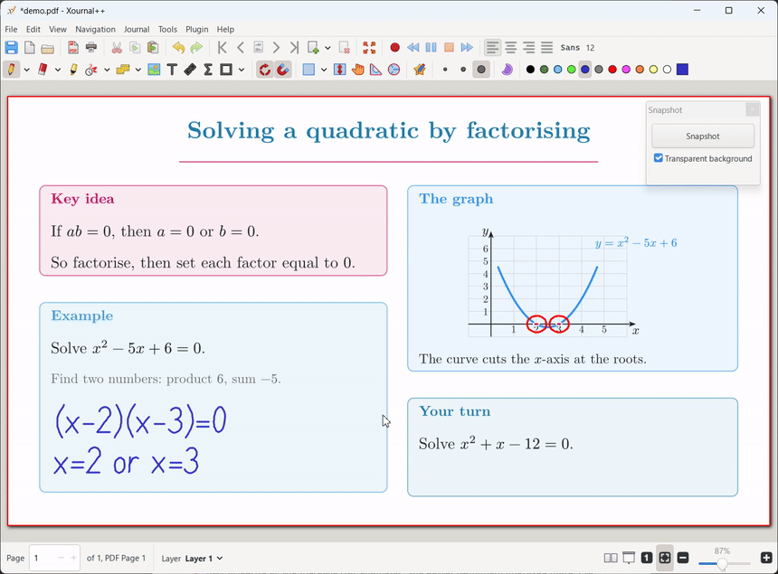
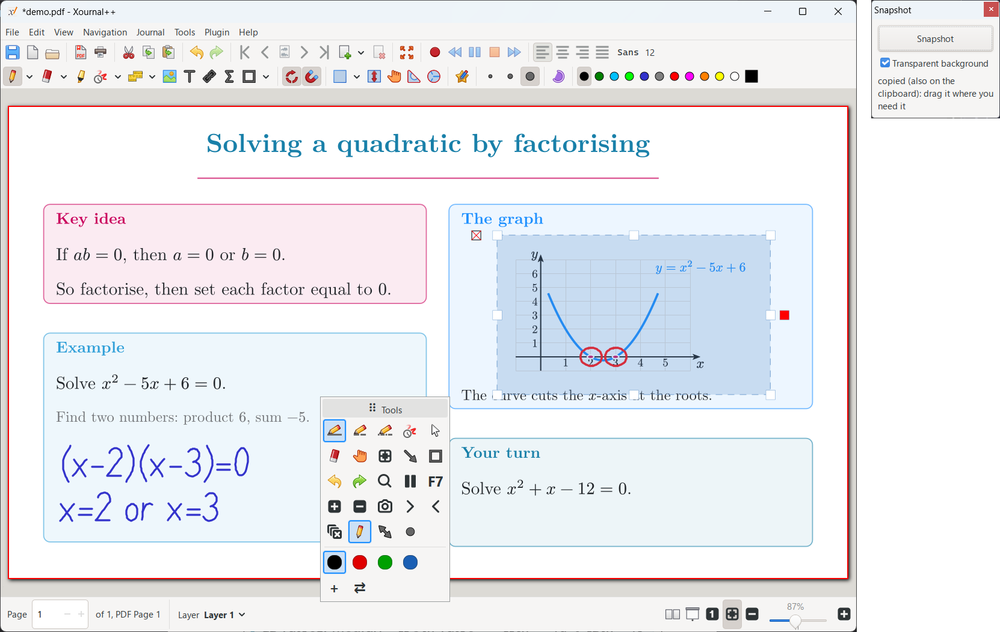
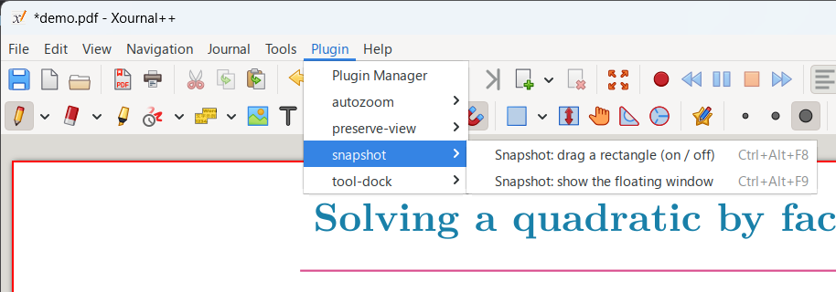

# snapshot

Copies part of the page as a picture you can drag: the PDF and everything written on it (pen,
highlighter, text, pictures, all visible layers). I use it to bring an earlier step or a diagram down next
to what I'm writing now.

Copy part of the page and drag it wherever you need it.

Version 0.11. Needs Xournal++ 1.3.8 or newer (stable or nightly). What changed in each version:
[CHANGELOG.md](CHANGELOG.md).

## How to use it

<picture>
  <source media="(prefers-color-scheme: dark)" srcset="../docs/images/snapshot-dark.png">
  
</picture>

1. Click **Snapshot** in the small floating window, or press Ctrl+Alt+F8. The tool changes to Select
   Rectangle.
2. Drag a box over the part you want.
3. When you let go, a copy sits on top of the original, already selected, and your earlier tool is back.
   Drag the copy where you need it. Ctrl+Z removes it.
4. The same picture is on the clipboard too, so you can paste it with Ctrl+V in Word, PowerPoint, Paint
   and so on.

To leave without copying: press the button or the key again, or pick any other tool.
Ctrl+Alt+F9 shows the floating window (it remembers its place).

<picture>
  <source media="(prefers-color-scheme: dark)" srcset="../docs/images/menu-snapshot-dark.png">
  
</picture>

## See-through background

The *Transparent background* tick box in the window is on by default. The page colour around your writing
is taken out, so the copy doesn't hide what's under it. You can lay it over a coloured box or other
work and you won't get a white square.

- The background is the most common colour in the box: white on the page, or the card colour inside a
  coloured card. A copy that holds a tinted card and the white page around it loses both.
- Text, pen writing, highlighter and strong colours (coloured bars, frames, title bands) stay.
- The soft edges of letters stay smooth, in the letter's own colour, so there's no white rim. Put back on
  the same background, the copy looks exactly like the original.
- Very pale things go with the background: a thin pale outline, a faint tint, light grey text, a very pale
  highlighter. A normal highlighter stays.

It works best on typed PDFs with flat colours (slides, textbooks, worksheets, light or dark pages). It
doesn't work well on:

1. Scanned pages and photos, where the paper isn't one colour. Even paper mostly works; with uneven light,
   patches stay.
2. Backgrounds with a colour gradient.
3. Letters in the background colour, for example white text in a coloured band on a white page: they become
   holes.

For these, untick *Transparent background* and you get a normal solid picture.

## Clipboard

Every copy also goes to the clipboard, at full sharpness, the same picture as on the page. Programs that
understand transparency get the see-through picture; programs that don't (Paint)
get it on the page colour. The window then says "copied (also on the clipboard)".

## Sharpness

The copy is made at 6 picture pixels per page point, which is sharp up to about 360 % zoom. If you're
zoomed in further, the picture follows your zoom so it stays sharp. A sharper copy takes a little longer
(about 0.4 s, up to about 0.8 s at the top limit).

## Settings (`settings.txt` in this folder)

The plugin writes this file itself. Change it with Xournal++ closed.

| Name | Default | What it means |
|---|---|---|
| `KEY_RECT` | `<Control><Alt>F8` | shortcut: copy mode on / off |
| `KEY_PANEL` | `<Control><Alt>F9` | shortcut: show the floating window |
| `TRANSPARENT` | true | see-through background (same as the tick box) |
| `FAINT_CUT` | 20 | see-through: what is left less solid than this (percent) goes too; 0 = off |
| `BG_SHARE` | 5 | see-through: how much of the copy (percent) a second background colour must fill |
| `BG_NEAR` | 60 | see-through: how close to the main background a second one must be (0 = one colour only) |
| `CLIPBOARD` | true | every copy also goes to the clipboard |
| `PX_PER_PT` | 4 | picture pixels per page point (was 6 before 0.11) |
| `ZOOM_HEADROOM` | 1.25 | zoomed in: picture pixels = screen pixels x this |
| `MAX_PAGE_PX` | 8000 | top limit of the exported page width |
| `MIN_SIZE` | 10 | smaller boxes (page points) are ignored |
| `OFFSET_X`, `OFFSET_Y` | 0 | where the copy lands next to the original (page points) |
| `EARLY_EXPORT` | true | get the page ready when the mode starts, so the copy appears at once |
| `EARLY_DELAY_MS` | 200 | how long after the press it starts (ms); the lit button and the tool change are drawn first |
| `LATE_MS` | 100 | a drag that began while Xournal++ was busy for longer than this (ms) is not used: drag again |
| `SETTLE_MS` | 80 | wait after you let go before copying |
| `PANEL_AT_START` | false | open the floating window when Xournal++ starts |
| `PAD`, `GAP` | 10, 15 | page spacing of Xournal++ (pixels) |
| `LOG` | true | write `%TEMP%\snapshot.log` |

## Good to know

- If something looks wrong, the log is in `%TEMP%\snapshot.log`.
- On every copy the plugin checks that it still understands Xournal++'s page layout. If a new Xournal++
  version changes it, the window says "copied (layout check failed, see the log)".
- The mode waits while another program is in front of Xournal++: a drag there copies nothing.
