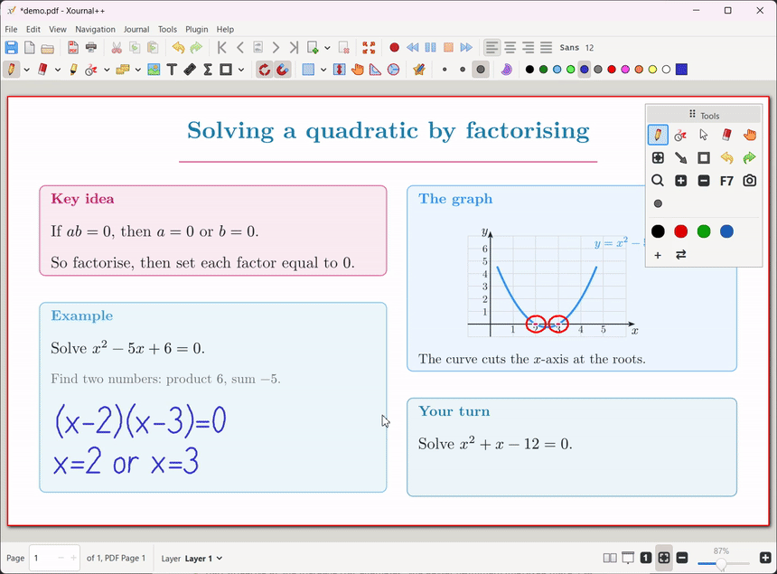
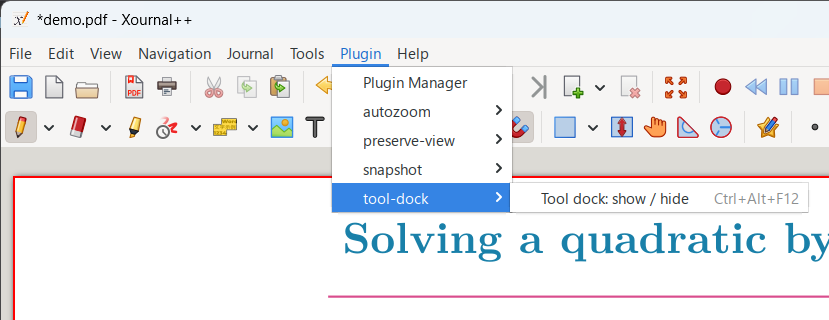
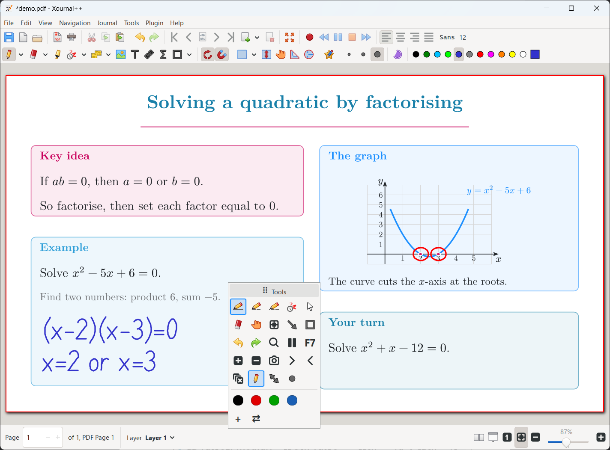
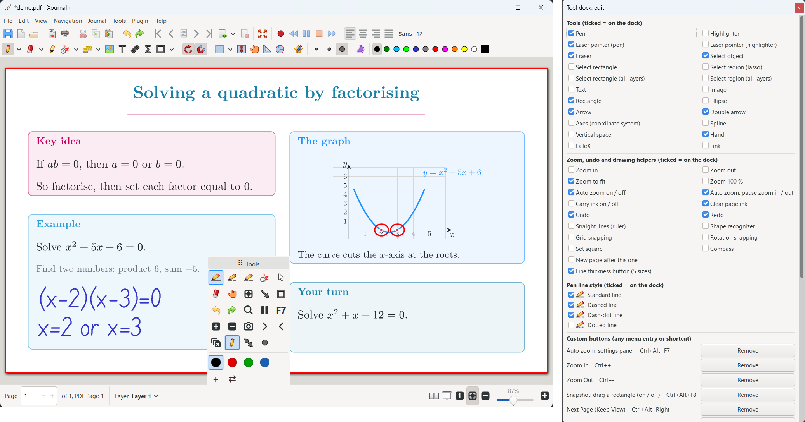

# tool-dock

A small floating panel with your tools, colours and line sizes. Put it anywhere over the page, right next
to where you write, so the pen never has to travel up to the toolbar. (With autozoom on, that trip would
also pass the top edge and slide the view.)

Move the dock next to your writing and pick your tools and colours right there.

Version 0.8.2. Needs Xournal++ 1.3.8 or newer (stable or nightly). What changed in each version:
[CHANGELOG.md](CHANGELOG.md).

## Keys (also in the Plugin menu)

| Key | Does | Name in settings.txt |
|---|---|---|
| Ctrl+Alt+F12 | show / hide the dock | `KEY_DOCK` |

<picture>
  <source media="(prefers-color-scheme: dark)" srcset="../docs/images/menu-tool-dock-dark.png">
  
</picture>

## The dock

<picture>
  <source media="(prefers-color-scheme: dark)" srcset="../docs/images/dock-dark.png">
  
</picture>

- **Tool buttons** (pen, laser pointer, select object and eraser to start with): a click switches to that
  tool. The active tool has a blue outline, also when you change the tool somewhere else (toolbar,
  shortcuts).
- **Colour buttons** (black, blue, red and green to start with): a click colours the current tool and
  anything selected. With a tool that has no colour (select, eraser, hand) the pen gets the colour, and a
  selection is still coloured. The current colour has a blue outline.
- **Line thickness button** (a dot): opens a picker with Xournal++'s 5 sizes, next to the dock. A click sets
  the size of the current tool, the same way the toolbar's size buttons do. Xournal++ keeps one size per
  tool, so each tool remembers its own size. With a tool that has no size (select, hand, text ...) the
  picker sets the pen's size.
- **Shape buttons** (arrow, rectangle, ellipse, axes, ruler ...): switch to the pen and turn that shape on.
  Press again for freehand. The button is lit while its shape is on.
- **Line style buttons** (standard, dashed, dash-dot, dotted): switch to the pen with that line style. The
  style you're drawing with is lit while you're on the pen. On another tool (laser, highlighter, eraser
  ...) none is lit, the same as Xournal++'s own *Pen Options* menu; the pen keeps its style and it lights
  up again when you go back to the pen. A shape stays on, so a dashed arrow works too.
- **+** opens the edit list. **⇄** switches the shape of the dock: a row, a column, or a block.
- **Move or remove a button:** hold it for a moment (0.6 s) or right-click it. A small window opens:
  - **◀ Move / Move ▶** (▲ / ▼ when the dock is a column) moves the button one place earlier or later. The
    window stays open, so press again to keep moving it. In a block, a button moves along the row and on
    to the next row. Colours move among the colours.
  - **Remove** takes it off the dock, **Close** keeps it.
  - The window doesn't block anything: you can still try the button on the dock. It closes by itself as
    soon as you start writing on the page.
  - The thickness button can't move, only go (bring it back with its tick in the edit list). The + and ⇄
    buttons always stay at the end.
- **Grip** (the dotted strip "⠿"): press on it and drag to move the dock. The dock has no title bar and no
  X: hide it with Ctrl+Alt+F12. Its place is remembered, and if that place is off the screen (after
  moving from a bigger monitor) it's pulled back on screen. The dock never takes the keyboard.
- The pen over the dock never zooms or slides the view.

## The edit list (+)

<picture>
  <source media="(prefers-color-scheme: dark)" srcset="../docs/images/dock-edit-dark.png">
  
</picture>

- **Tools:** every tool your Xournal++ has, with a tick box. Ticked = on the dock. A new tick goes to the
  end; move it from there with a long press (see above).
- **Zoom, undo and drawing helpers:** zoom in / out / fit / 100 %, undo, redo, ruler, shape recognizer,
  grid and rotation snapping, set square, compass, new page, with the same tick boxes. Below them: the line
  thickness button.
- **Pen line style:** standard, dashed, dash-dot and dotted, each with Xournal++'s own icon. None are on
  the dock to start with.
- **Auto zoom on / off** (magnifier icon): does what Ctrl+Alt+F5 does, and is lit while auto zoom is on.
  Shown only when the autozoom plugin is installed.
- **Auto zoom: pause zoom in / out** (pause icon): stops auto zoom zooming in and out by itself, while the
  edge slide and the follow glide keep working. Lit while paused. Needs autozoom 0.16.
- **Carry ink on / off** (copy icon) and **Clear page ink** (broom icon): preserve-view's carry ink, see its
  README. Carry ink is lit while on. Shown only when preserve-view is installed.
- **Colours:** each colour with a Remove button, and "Add colour ..." (the normal colour picker).
- **Shape:** a row, a column, or a block with 1 to 12 buttons per row.
- **Button size:** small, medium or large.
- **Start-up:** open the dock when Xournal++ starts.
- **Custom buttons:** see below.

Every change shows at once and is saved by itself. The edit list scrolls when it's taller than the screen.
Drag its top or bottom edge to make it taller or shorter; it keeps that height next time.

## Custom buttons

A custom button does what a menu item does: next page (keep view), snapshot, a drawing mode ... anything in
the Xournal++ menus that has a shortcut, and everything in the Plugin menu.

1. Click **+** on the dock, then **Add a custom button ...** under *Custom buttons*.
2. A list opens with every menu item and its shortcut, grouped by menu (File, Edit, View, Navigation,
   Journal, Tools, Plugin). Items already on the dock are greyed out. Items a tick box already gives (pen,
   shapes, undo, zoom ...) are left out: tick those instead.
3. Tap one. The dock gets the new button at the end. Add as many as you like.

- The button runs the menu item itself (it doesn't fake a key press), so it still works if you change the
  key.
- It shows an icon when it knows the item (magnifier = auto zoom, camera = snapshot, arrows = next /
  previous page, the tool's own icon for Pen, Eraser, Undo, Zoom In ...), otherwise the end of its shortcut,
  for example "F9". Hover over it to see its full name and shortcut.
- It's lit while the item is on (a tick or tool item in the menu, auto zoom, or snapshot while it waits
  for your drag: needs snapshot 0.11).
- Careful with items like Quit, Delete Page, Fullscreen or Presentation Mode: they do exactly that.

## Settings (`settings.txt` in this folder)

The plugin writes this file itself. You can edit it with Xournal++ closed.

| Setting | Default | What it means |
|---|---|---|
| `TOOLS` | `pen,laserPen,selectObject,eraser` | tool buttons, in order (names listed at the top of the file) |
| `COLOURS` | `000000,1E5AE6,E00000,00A000` | colour buttons, RRGGBB |
| `SHAPE` | `horizontal` | `horizontal`, `vertical` or `rectangle` |
| `PER_ROW` | 4 | buttons per row in the rectangle shape (1 to 12) |
| `SIZE` | `medium` | `small`, `medium` or `large` |
| `SIZE_BUTTON` | true | show the line thickness button |
| `DOCK_AT_START` | false | show the dock when Xournal++ starts |
| `LONG_MS` | 600 | how long you hold a button for "Remove" (200 to 3000 ms) |
| `KEY_DOCK` | `<Control><Alt>F12` | shortcut key, `none` = no key |
| `CUSTOM<n>` | (none) | a custom button: menu, item, shortcut, e.g. `CUSTOM1=Plugin\|Auto zoom: ON / OFF\|Ctrl+Alt+F5` |
| `PANEL_X`, `PANEL_Y`, `EDIT_X`, `EDIT_Y` | -100000 | window places (saved by themselves) |
| `EDIT_H` | 0 | edit list height after you resized it (0 = natural height) |
| `TICK_MS`, `LOG` | 30, true | timer interval; log to `%TEMP%\tool-dock.log` |

Bad values (an unknown tool name, a colour like `12345G`, `PER_ROW=0`) are left out or corrected, with a
line in the log.

## Good to know

- If something looks wrong, the log is in `%TEMP%\tool-dock.log`.
- On Linux with Wayland the dock can't be dragged by its grip and its saved place is ignored. Start
  Xournal++ with `GDK_BACKEND=x11 xournalpp` instead.
